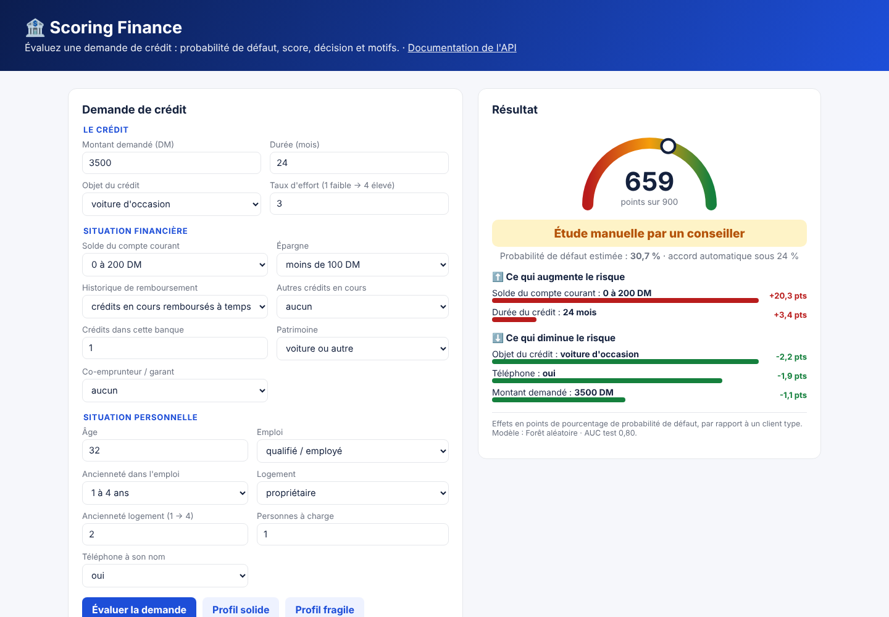
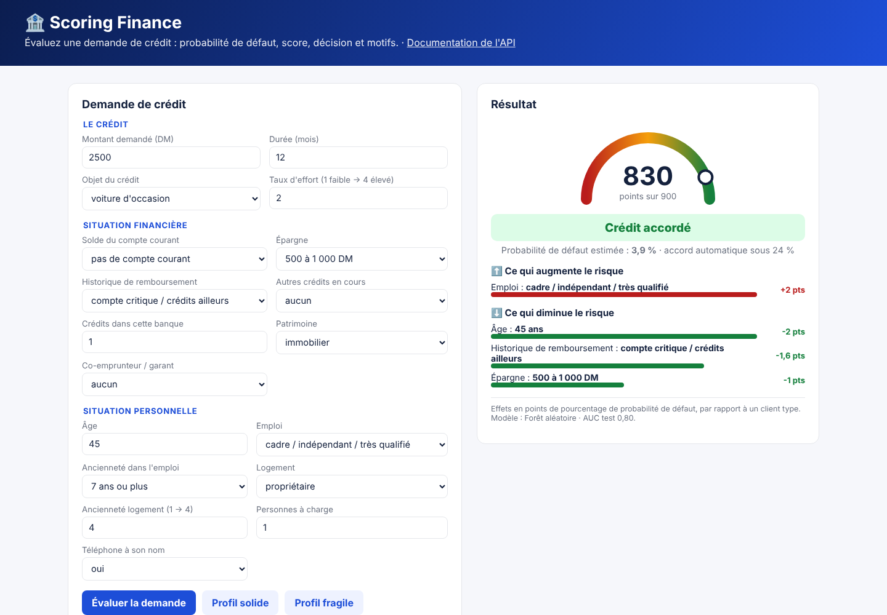
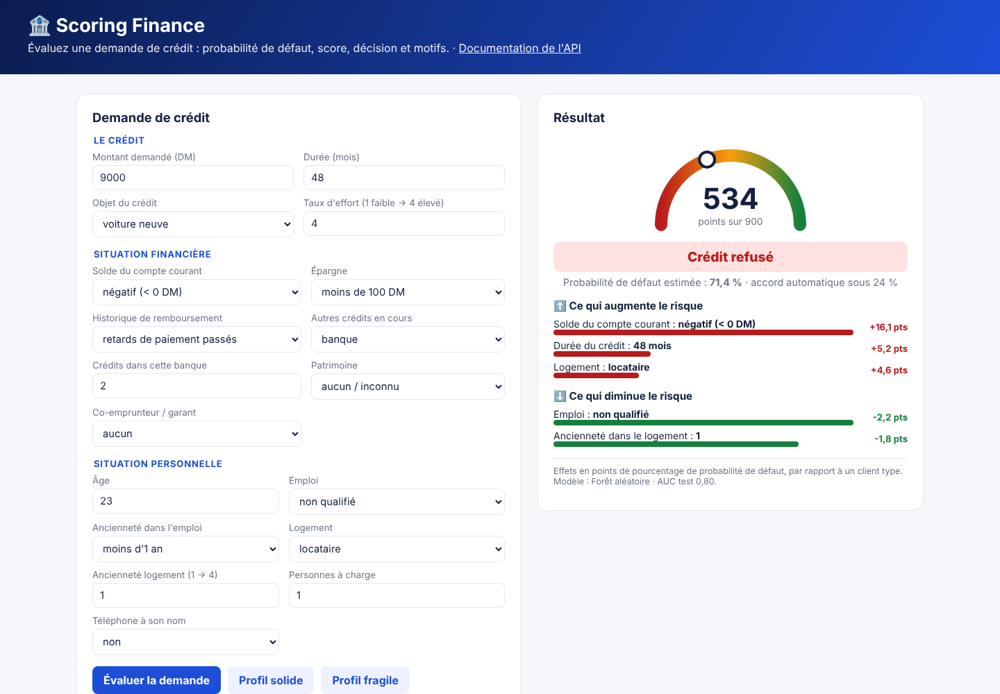
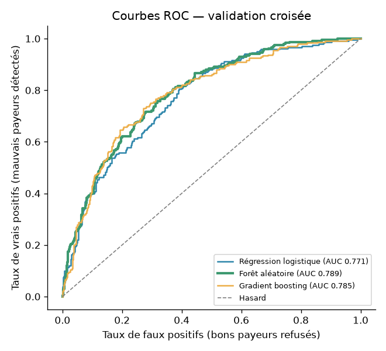
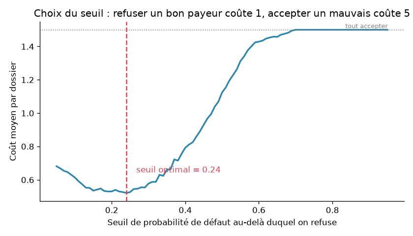
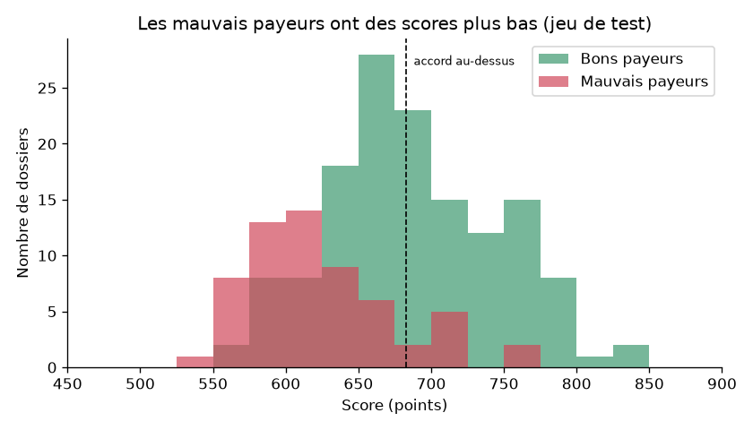
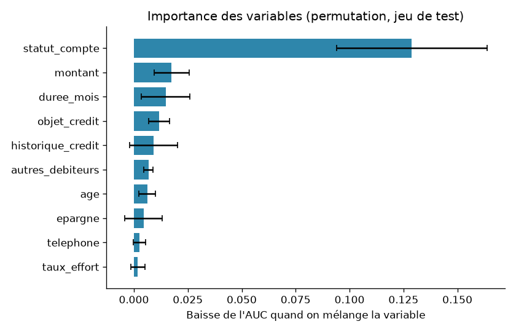

<div align="center">

# 🏦 Scoring Finance

**Un modèle de scoring de crédit de bout en bout : de la donnée brute à une API qui décide et explique ses décisions.**




</div>

---

## 📌 Sommaire
- [Le problème](#-le-problème)
- [Résultats](#-résultats)
- [La démarche, étape par étape](#-la-démarche-étape-par-étape)
- [L'API](#-lapi)
- [Lancer le projet](#-lancer-le-projet)
- [Organisation du code](#-organisation-du-code)
- [Limites et pistes](#-limites-et-pistes)

---

## 🎯 Le problème

Une banque reçoit une demande de crédit. Doit-elle l'accorder ?

Le projet répond à trois questions :
1. **Quel est le risque ?** Probabilité que le client ne rembourse pas (défaut), traduite en **score de 300 à 900 points**.
2. **Que décider ?** Accord automatique, étude par un conseiller ou refus, avec un seuil fixé selon le **coût réel des erreurs**.
3. **Pourquoi ?** Les **motifs** de la décision, client par client, comme l'exige la réglementation européenne sur le crédit.

**Données** : [Statlog German Credit](https://archive.ics.uci.edu/dataset/144/statlog+german+credit+data) (UCI), 1 000 demandes de crédit,
20 variables, **30 % de mauvais payeurs**. Licence CC BY 4.0.

---

## 📊 Résultats

| | |
|---|---|
| **Modèle retenu** | Forêt aléatoire (comparée à une régression logistique et à un gradient boosting) |
| **AUC (jeu de test)** | **0,80** · Gini 0,60 · KS 0,51 |
| **Mauvais payeurs détectés** | **87 %** (52 sur 60) |
| **Coût moyen par dossier** | **0,535**, contre 1,50 en acceptant tout le monde (**−64 %**) et 0,70 en refusant tout le monde |
| **Seuil de décision** | accord automatique si la probabilité de défaut est **sous 24 %** |

<table>
<tr>
<td width="50%"><p align="center"><em>Profil solide : score 830, crédit accordé</em></p></td>
<td width="50%"><p align="center"><em>Profil fragile : score 534, crédit refusé, avec les motifs</em></p></td>
</tr>
</table>

---

## 🔬 La démarche, étape par étape

### 1. Exploration des données → [`notebooks/exploration.ipynb`](notebooks/exploration.ipynb)
- Le fichier d'origine est codé (A11, A34…) : chaque code est traduit en libellé français d'après la documentation officielle.
- **Signal le plus fort : le compte courant.** 49 % de défaut si le solde est négatif, 12 % sans compte courant dans la banque.
- Le risque augmente avec la **durée** du crédit : 21 % jusqu'à 12 mois, 52 % au-delà de 36 mois.
- Un **paradoxe connu** : les clients ayant des crédits ailleurs font moins défaut que ceux sans historique.

### 2. Variables sensibles : exclues du modèle
Le **sexe, la situation familiale et la nationalité ne sont pas utilisés** : refuser un crédit sur ces critères serait discriminatoire.
Ils sont gardés uniquement pour **auditer** les décisions après coup (étape 7).

### 3. Comparaison de modèles (validation croisée à 5 plis)
| Modèle | AUC moyenne | Écart-type |
|---|:-:|:-:|
| **Forêt aléatoire** | **0,790** | 0,043 |
| Gradient boosting | 0,786 | 0,046 |
| Régression logistique | 0,773 | 0,057 |

Règle de choix fixée **avant** de voir les résultats : on prend le meilleur AUC, sauf si la régression logistique est à moins de 0,01
(on la préférerait alors, car plus simple et plus stable). Ici l'écart est de 0,017 : **la forêt aléatoire est retenue**.



### 4. Le seuil de décision : choisi par le coût, pas à 50 %
Accorder un crédit à un mauvais payeur coûte **5 fois plus** que refuser un bon payeur (matrice de coûts fournie avec les données).
Le seuil est donc choisi pour **minimiser le coût moyen**, sur des prédictions hors échantillon : **24 %**.



Trois zones de décision :
| Probabilité de défaut | Décision |
|---|---|
| moins de 24 % | ✅ Crédit accordé automatiquement |
| de 24 % à 50 % | 🟠 Étude manuelle par un conseiller |
| 50 % ou plus | ❌ Crédit refusé |

> Pourquoi pas la précision (*accuracy*) ? Elle n'est que de 62,5 % au seuil retenu, parce que le modèle préfère refuser un bon payeur
> plutôt que d'accepter un mauvais. C'est **voulu** : c'est ce qui minimise le coût réel.

### 5. Un score en points
La probabilité est convertie en score, comme le font les banques : **600 points = 1 chance sur 2 de défaut**,
et chaque **+50 points divise par deux** le rapport risque / non-risque.

| Probabilité de défaut | 5 % | 10 % | 20 % | 30 % | 50 % | 70 % |
|---|:-:|:-:|:-:|:-:|:-:|:-:|
| **Score** | 812 | 758 | 700 | 661 | 600 | 539 |



### 6. Expliquer chaque décision
Pour chaque client, chaque variable est remplacée par la valeur d'un **client type**, puis on mesure l'effet sur la probabilité de défaut.
La méthode fonctionne avec **n'importe quel modèle**. L'API renvoie les 3 facteurs qui augmentent le plus le risque et les 3 qui le diminuent le plus.

Au niveau global, l'**importance par permutation** confirme que le compte courant domine :



### 7. Audit d'équité → [`reports/model_card.md`](reports/model_card.md)
Taux d'accord automatique par groupe sur le jeu de test (variables **non utilisées** par le modèle) :
- **Sexe** : 36 % pour les femmes, 42 % pour les hommes → ratio 0,85, au-dessus du seuil de 0,8 ✅
- **Âge** : 20 % pour les moins de 25 ans, 45 % pour les autres → ratio 0,45 ⚠️. Les moins de 25 ans ont aussi un taux de défaut réel
  plus élevé (49 % contre 25 %), mais l'écart d'accord est plus fort que l'écart de risque : **à analyser avant toute utilisation réelle**.
- **Nationalité** : un des groupes ne compte que 6 dossiers, trop peu pour conclure.

---

## 🔌 L'API

| Méthode | Route | Rôle |
|---|---|---|
| `GET` | `/` | Page de démonstration (formulaire + résultat) |
| `GET` | `/health` | L'API tourne-t-elle, le modèle est-il chargé ? |
| `GET` | `/model` | Type de modèle, seuil, performances, valeurs acceptées |
| `POST` | `/predict` | Score d'une demande, avec décision et motifs |
| `POST` | `/predict/batch` | Jusqu'à 100 demandes en une fois |

Documentation interactive (Swagger) : **http://localhost:8000/docs**

Les entrées sont **validées** par Pydantic : une catégorie inconnue ou un âge de 12 ans renvoie une erreur 422.

```bash
curl -X POST http://localhost:8000/predict -H "Content-Type: application/json" -d '{
  "statut_compte": "0 à 200 DM", "duree_mois": 24, "historique_credit": "crédits en cours remboursés à temps",
  "objet_credit": "voiture d'\''occasion", "montant": 3500, "epargne": "moins de 100 DM",
  "anciennete_emploi": "1 à 4 ans", "taux_effort": 3, "autres_debiteurs": "aucun", "anciennete_residence": 2,
  "patrimoine": "voiture ou autre", "age": 32, "autres_credits": "aucun", "logement": "propriétaire",
  "nb_credits": 1, "emploi": "qualifié / employé", "nb_personnes_a_charge": 1, "telephone": "oui"}'
```
```json
{
  "probabilite_defaut": 0.3073,
  "score": 659,
  "decision": {"code": "etude", "libelle": "Étude manuelle par un conseiller"},
  "seuil": 0.24,
  "facteurs_risque": [
    {"variable": "statut_compte", "libelle": "Solde du compte courant", "valeur": "0 à 200 DM", "effet": 20.3},
    {"variable": "duree_mois", "libelle": "Durée du crédit", "valeur": "24 mois", "effet": 3.4}
  ],
  "facteurs_favorables": [
    {"variable": "objet_credit", "libelle": "Objet du crédit", "valeur": "voiture d'occasion", "effet": -2.2}
  ]
}
```
`effet` = variation de la probabilité de défaut, en points de pourcentage, par rapport au client type.

---

## 🚀 Lancer le projet

**Prérequis** : Python 3.11 ou plus récent.

**Windows, en un double-clic** : `lancer.bat` installe tout, entraîne le modèle si besoin, puis ouvre la démo.

**À la main :**
```bash
python -m venv .venv
# Windows : .venv\Scripts\activate     macOS / Linux : source .venv/bin/activate
pip install -r requirements.txt

cd src && python -m scoring.train && cd ..   # (optionnel) réentraîner : ~1 minute
uvicorn api.main:app --reload                 # API + démo sur http://localhost:8000
pytest -v                                     # 15 tests
```

**Avec Docker :**
```bash
docker build -t scoring-finance .
docker run -p 8000:8000 scoring-finance
```

L'intégration continue (GitHub Actions) **réentraîne le modèle depuis zéro** à chaque push, puis lance les tests.

---

## 🗂️ Organisation du code

```
scoring-finance/
├── data/raw/german.data          Données d'origine (UCI), non modifiées
├── src/scoring/
│   ├── data.py                   Chargement, décodage des codes, variables sensibles, matrice de coûts
│   ├── model.py                  Pipelines, coût, seuil, score en points, décision, explications
│   └── train.py                  Entraînement complet : comparaison, seuil, test, équité, figures, model card
├── api/
│   ├── main.py                   API FastAPI
│   ├── schemas.py                Validation des entrées / sorties (Pydantic)
│   └── static/index.html         Page de démonstration
├── models/model.joblib           Modèle entraîné (pipeline + seuil + client type)
├── reports/
│   ├── metrics.json              Toutes les métriques
│   ├── model_card.md             Fiche du modèle : usage, performances, équité, limites
│   └── figures/                  ROC, coût, scores, calibration, importance
├── notebooks/exploration.ipynb   Exploration des données
├── tests/                        15 tests : données, règles métier, API
├── Dockerfile · Makefile · lancer.bat
└── .github/workflows/ci.yml      Entraînement + tests à chaque push
```

**Choix de conception**
- La **préparation des données est dans le pipeline** scikit-learn : l'API applique exactement les mêmes transformations qu'à l'entraînement.
- Les règles métier (coût, seuil, score, décision) sont dans **un seul module**, partagé par l'entraînement et l'API.
- Le **seuil, le client type et les métriques sont sauvegardés avec le modèle** : un seul fichier à déployer.

---

## 🧭 Limites et pistes

- Données anciennes (Allemagne, années 1970-1990, en Deutsche Marks) et seulement 1 000 dossiers : les résultats illustrent une méthode,
  ils ne sont pas transposables tels quels.
- Les probabilités sont moyennement calibrées (voir `reports/figures/calibration.png`) : une calibration (isotonique) serait utile avec plus de données.
- Le biais lié à l'âge doit être analysé, et éventuellement corrigé, avant tout usage réel.
- Pistes : suivi de la dérive des données en production (MLOps), journalisation des décisions, explications SHAP.

---

## 👤 Auteur

**Elie Samson Kombiwo** — Data Scientist (MLOps / LLMOps)
[GitHub](https://github.com/gitsam1path) · [LinkedIn](https://www.linkedin.com/in/elie-samson-kombiwo-4075a4284)

<sub>Données : Hofmann, H. (1994). Statlog (German Credit Data). UCI Machine Learning Repository. CC BY 4.0.</sub>
